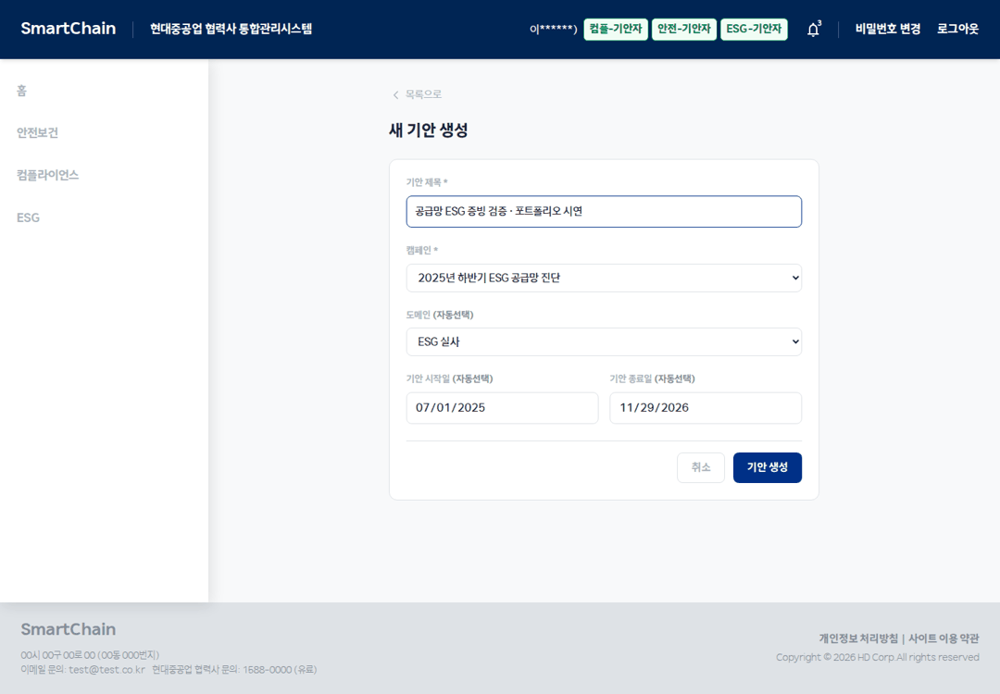

# SmartChain 실제 화면 시연

2026-10-29, 실제 Spring Boot·PostgreSQL·AI Run API·React 서비스를 localhost에서 함께 실행해 캡처했습니다. 증빙은 시연용 합성 문서이며 OpenAI와 Clova OCR은 실제로 호출했습니다.

|단계|화면|
|---|---|
|1|[캠페인에 연결한 기안 생성](01-create.webp)|
|2|[증빙 업로드·슬롯 분류](02-upload.webp)|
|3|[슬롯별 AI 판정과 근거](03-analysis.webp)|
|4|[회사 결재자 검토](04-approval.webp)|
|5|[원청 심사 화면](05-review.webp)|
|6|[보완 요청 이후 상태와 이력](06-revision.webp)|
|7|[최종 승인 이후 상태와 이력](07-completed.webp)|

GIF는 실제 단계별 화면 7개를 연결한 15.4초 시연입니다. 기안 생성은 브라우저에서, 업로드·분석·결재·심사 상태 전이는 실제 HTTP API로 실행한 후 화면을 확인했습니다. 원본 PNG의 표시 내용은 무손실 WebP로 보존했습니다.

[검증 기록·소스 커밋](https://github.com/withoutsultang/SmartChain_AI/blob/main/docs/verification.md) · [성공 실행](https://github.com/withoutsultang/SmartChain_AI/actions/runs/40825484560)
